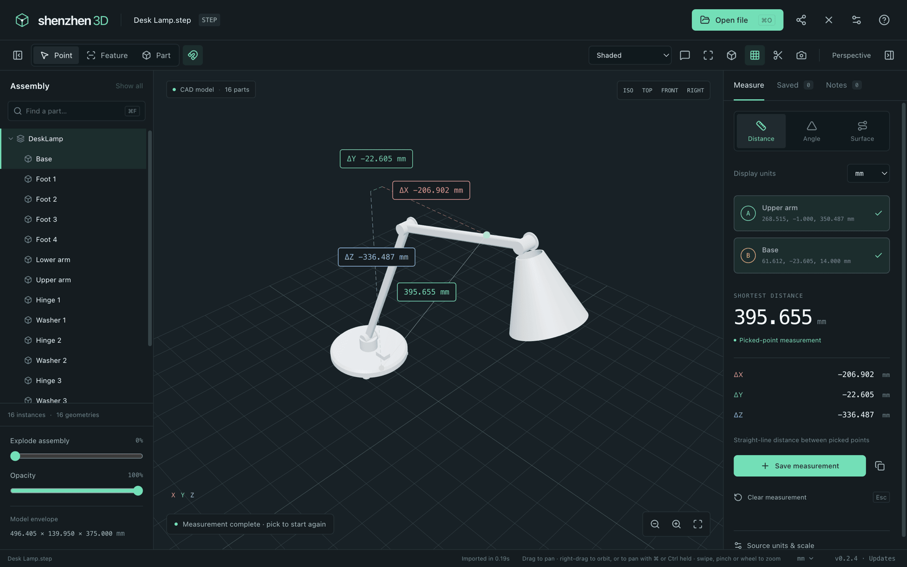
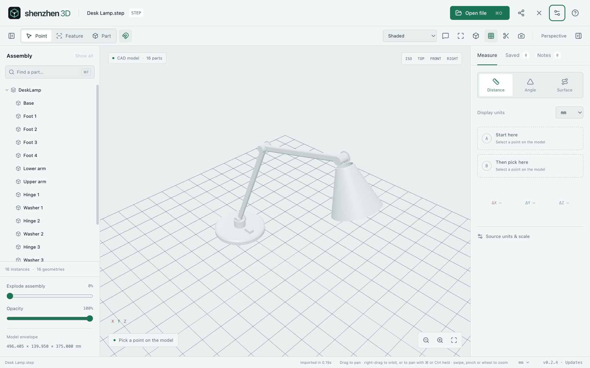

# Shenzhen 3D

A free viewer for CAD models, meshes and drawings: open an assembly, find a part, and take measurements you can trust. It runs on Mac, Windows, Linux, Android, iPhone and iPad, and in a browser. Your files stay on your device.

[0.2.5 release notes](docs/MAC-0.2.5.md) · [Download from Releases](https://github.com/casimir-engineering/shenzhen-3D/releases) · [Platform delivery and validation](docs/DELIVERY.md)



<sub>Screenshots use a made-up desk lamp model.</sub>

## Open

- **CAD:** STEP, IGES and BREP, with the assembly tree and exact feature measurements.
- **Meshes and drawings:** common mesh formats, DXF and DWG drawings, and SVG, measured from their geometry. [Formats and limits](docs/FORMATS.md)
- SolidWorks, CATIA and other proprietary files need exporting to one of these first.

## Measure

- Distances between points, with ΔX, ΔY and ΔZ, and angles from three points.
- On CAD models: shortest distances, lengths, areas, radius and diameter, angles, thickness and centres.
- On meshes: approximate flat areas and perimeters, circles fitted to edges, and paths across a surface.
- Choose units, scale and precision; save measurements and export them as CSV or JSON.

## Look around

- Find, show, hide and isolate parts; explode the assembly, fade it, cut it with a section plane, or jump to a standard view.
- Shaded, edges, wireframe and hidden-line views, light and dark themes, and optional ray tracing on capable GPUs. [Rendering](docs/RENDERING.md)
- Thin markings and labels stay sharp at every zoom. Large assemblies stay smooth: the [performance report](docs/PERFORMANCE.md) shows 120 fps on a 376,000-part scene on an M5 Max.
- Drag to pan, right-drag to orbit, pinch or scroll to zoom. **⌘K** (Ctrl+K on Windows, Linux and Android) finds any command. [Controls](docs/CONTROLS.md)



## Share and review

- Pin comments to parts, points, edges or faces, then edit and resolve them.
- Share one `.sz3d` file that holds the model, its comments and the saved measurements. [Review files](docs/REVIEW.md)

## Friends (Beta)

Message people nearby or by their Friends ID, and send them models and projects, in every version except the browser one. It is the same Friends as in ShenzhenPDF and Shenzhen Files. Type **#** to attach the open model, marked **Current**, or paste copied files and pictures. [Shenzhen Friends](docs/FRIENDS.md)

## Download

From the [Releases](https://github.com/casimir-engineering/shenzhen-3D/releases) page:

- **Mac** (Apple Silicon, macOS 13 or later): the `.dmg`.
- **Windows** (x64): the `Setup.exe` or the `.msi`. They are not signed yet, so Windows may warn you.
- **Linux** (ARM64): the `.AppImage`, `.deb` or `.rpm`.
- **Android** (ARM64): the `.apk`.
- **iPhone and iPad:** only on devices registered for testing.
- **Browser:** the `web.zip`, served over HTTP or HTTPS.

The apps tell you when a new version is out. On Mac, Windows, Linux (AppImage) and Android they install it once you agree.

## Run locally

Use Node.js 24 or newer:

```sh
npm ci
npm run dev
```

Open `http://localhost:1420`. Choose **Sample model** or open/drop a model. Select the model and its companion textures, MTL or BIN files together. **P** picks points, **E** picks features, **F** fits the view, and **Esc** clears a measurement. The measurement panel exposes units, scale and distance references; save useful results and export them before closing the session. **C** adds an anchored note; **⌘ / Ctrl S** shares the model, comments and saved measurements as one portable project. **⌘ / Ctrl K** finds any command, and in the apps with Friends, **⌘ / Ctrl J** opens or closes Friends ([controls](docs/CONTROLS.md#app-shortcuts)).

Production web builds include a generated service worker for offline use after the app assets have been cached successfully. Installation starts after the welcome screen paints and a four-second grace period, then copies assets with at most two background requests; keep the first session online until that copy completes. Model files, annotations and saved measurement sessions are not stored by that cache; save a `.sz3d` project to retain them. Native shells bundle the application assets.

See [building and testing](docs/BUILDING.md), [platform requirements and current evidence](docs/PLATFORMS.md), [CAD/measurement validation](docs/VALIDATION.md), [format validation](docs/FORMAT_VALIDATION.md), and [third-party components](docs/THIRD_PARTY.md). Configured platform builds are not evidence that every platform has been packaged or tested on a device.

## Licence

Shenzhen 3D is free software under the GNU General Public License, version 3 or (at your option) any later version. See [LICENSE](LICENSE). Third-party components keep their own licences; see [third-party components](docs/THIRD_PARTY.md).
