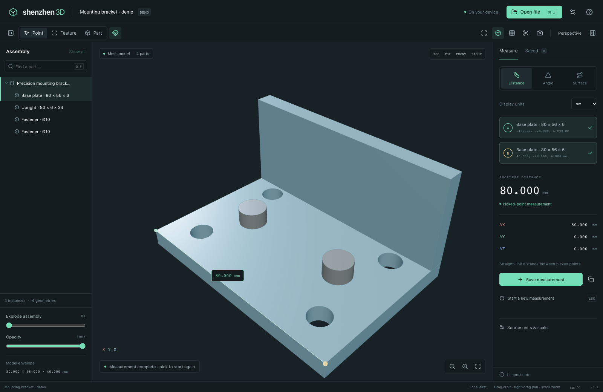
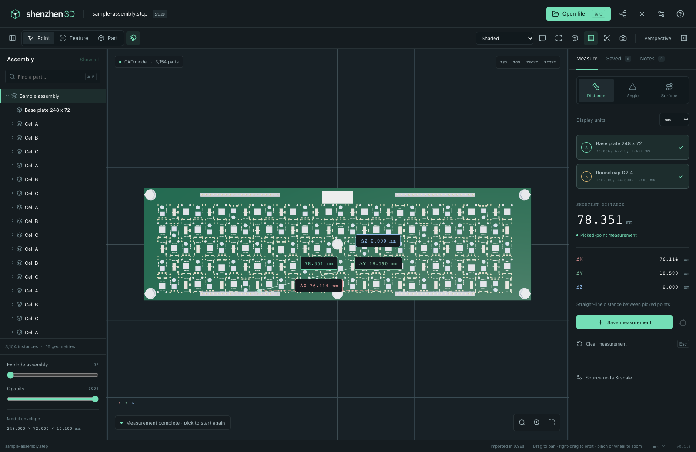

# Shenzhen 3D

A CAD, mesh and drawing viewer for inspecting assemblies and taking engineering measurements. One React/Three.js interface runs in the browser/PWA, a Chromium desktop performance shell, and lightweight Tauri desktop/mobile shells. Model files are processed on the device.

[Mac 0.2.4 release notes](docs/MAC-0.2.4.md) · [Platform delivery and validation](docs/DELIVERY.md)

Download installers from this repository’s **Releases** page.



Open STEP, IGES or BREP for CAD topology and exact supported feature queries; open common mesh formats, DXF/DWG drawings or SVG for inspection and geometry-based measurements. [Format support and limits](docs/FORMATS.md) distinguish these paths. Native SolidWorks, CATIA and other proprietary authoring formats require export to a supported interchange format.

- Point distance with signed ΔX/ΔY/ΔZ and Euclidean length; three-point angles.
- CAD feature minimum distance, lengths, areas, radius/diameter, supported angles and normal thickness; centers/centroids where available.
- Approximate mesh coplanar area/perimeter, circular-boundary fitting and surface routes.
- Assembly search, visibility and isolation; explode, opacity, section plane and standard views.
- Source-unit overrides, custom measurement scale, display units and precision; saved session measurements exported as CSV/JSON and viewport screenshots as PNG.
- Comments attached to parts, points, edges, faces or vertices; edit, resolve and share portable `.sz3d` files containing the model and saved measurements. [Review files](docs/REVIEW.md).
- Shaded, shaded-with-edges, wireframe and dashed hidden-line views; movable key light and uniform fill. Optional progressive WebGPU ray tracing with raster navigation and measurement overlays. [Rendering and device limits](docs/RENDERING.md).
- Automatic controls: left/middle drag pans, right-drag orbits around the view center (hold Command or Ctrl to pan instead), two-finger trackpad swipes zoom (hold Command or Ctrl to pan), and pinch/mouse wheel zoom. Dark/light themes. [Controls and browser limits](docs/CONTROLS.md).
- Shenzhen Friends (beta) in the Mac app: message friends and send them models and projects, nearby or by Friends ID, shared with ShenzhenPDF and Shenzhen Files. [Shenzhen Friends](docs/FRIENDS.md).
- Lightweight startup: the welcome screen opens before loading the 3D engine. Geometry tools load on first import; project archives and ray tracing load when needed. [Startup measurements](docs/STARTUP.md).
- GPU instancing and merged material draws, spatially indexed picking, and automatic navigation detail for large assemblies. Full geometry returns when still; measurements always use the original model.

The [hardware performance report](docs/PERFORMANCE.md) records 120 fps in Chromium on an M5 Max for a 376,000-part stress scene and for 37,600 independently rendered meshes. It includes exact workloads, actual submitted triangle counts, before/after data and platform limits. Choose **Full detail** in Settings to disable navigation detail.

## Run locally

Use Node.js 24 or newer:

```sh
npm ci
npm run dev
```

Open `http://localhost:1420`. Choose **Sample model** or open/drop a model. Select the model and its companion textures, MTL or BIN files together. **P** picks points, **E** picks features, **F** fits the view, and **Esc** clears a measurement. The measurement panel exposes units, scale and distance references; save useful results and export them before closing the session. **C** adds an anchored note; **⌘ / Ctrl S** shares the model, comments and saved measurements as one portable project. **⌘ / Ctrl K** finds any command, and in the apps with Friends, **⌘ / Ctrl J** opens or closes Friends ([controls](docs/CONTROLS.md#app-shortcuts)).

Production web builds include a generated service worker for offline use after the app assets have been cached successfully. Installation starts after the welcome screen paints and a four-second grace period, then copies assets with at most two background requests; keep the first session online until that copy completes. Model files, annotations and saved measurement sessions are not stored by that cache; save a `.sz3d` project to retain them. Native shells bundle the application assets.

See [building and testing](docs/BUILDING.md), [platform requirements and current evidence](docs/PLATFORMS.md), [CAD/measurement validation](docs/VALIDATION.md), [format validation](docs/FORMAT_VALIDATION.md), and [third-party components](docs/THIRD_PARTY.md). Configured platform builds are not evidence that every platform has been packaged or tested on a device.

The included sample assembly, `fixtures/sample-assembly.step`, places 3,154 parts using 16 shared geometries. The screenshot below shows a point measurement on it.



## Licence

Shenzhen 3D is free software under the GNU General Public License, version 3 or (at your option) any later version. See [LICENSE](LICENSE). Third-party components keep their own licences; see [third-party components](docs/THIRD_PARTY.md).
