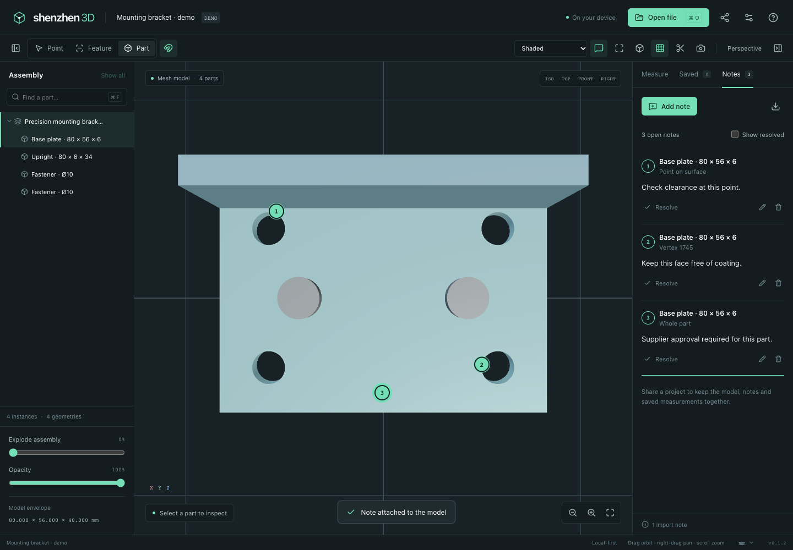

# Comments and portable review files

Open a model and use **Notes → Add note**, or press **C**. Choose a specific point, model feature (face, edge or vertex), or whole part, then select it on the model and write a note. Numbered pins connect each comment to its location. Click a pin or a note's location to focus it. Notes can be edited, resolved, reopened or deleted; the resolved filter keeps completed feedback accessible.

**Share commented project** (or **⌘ / Ctrl S**) creates a `.sz3d` file. On a browser/device supporting file sharing, it opens the system share sheet; otherwise it saves the file. Send this file to a recipient and open it in Shenzhen 3D to continue reviewing. It contains the original model and selected companion files, notes, saved measurements, tessellation quality, source/display units and custom scale. The built-in sample is stored as a reproducible demo reference. Files are processed locally.

When reopening, the original source is imported again. Part placement, geometry fingerprints and feature descriptors are checked before notes and measurements are attached to fresh runtime IDs. Missing or changed bindings produce a visible warning instead of silently moving feedback to another feature. Exact CAD handles are recreated by the CAD kernel and never persisted as reusable pointers.

Comments are plain text. The archive reader validates names, checksums, supported metadata, finite coordinates and size/count limits before expanding a project. Current limits include 256 MiB compressed, 512 MiB expanded, 256 source files, 2,000 notes and 1,000 measurements. Source files with duplicate basenames cannot be shared together because companion resolution uses basenames. These limits apply to review archives; ordinary model imports have separate resource constraints.

Notes and measurements remain in the current session until shared/exported. Review files are editable snapshots: recipients exchange updated files to pass revisions back. They do not synchronize live between devices.
