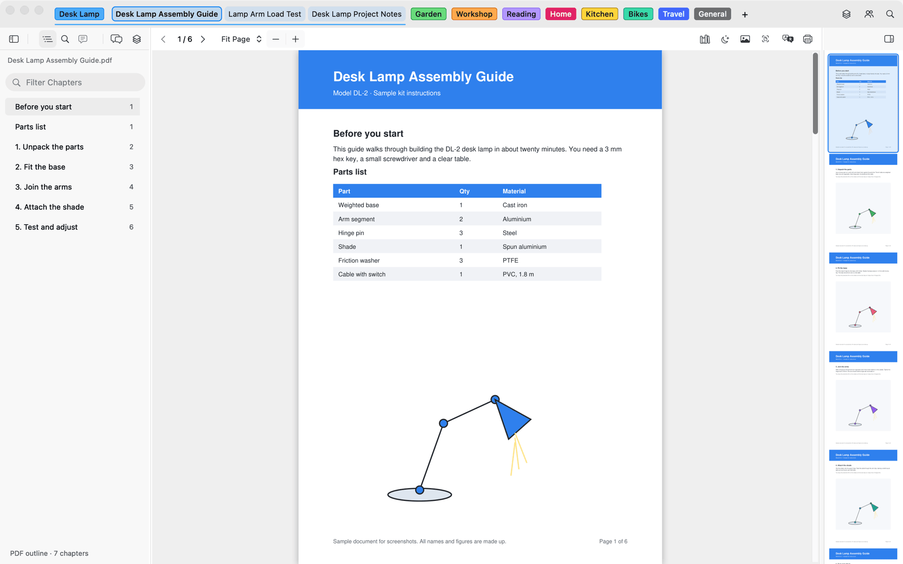
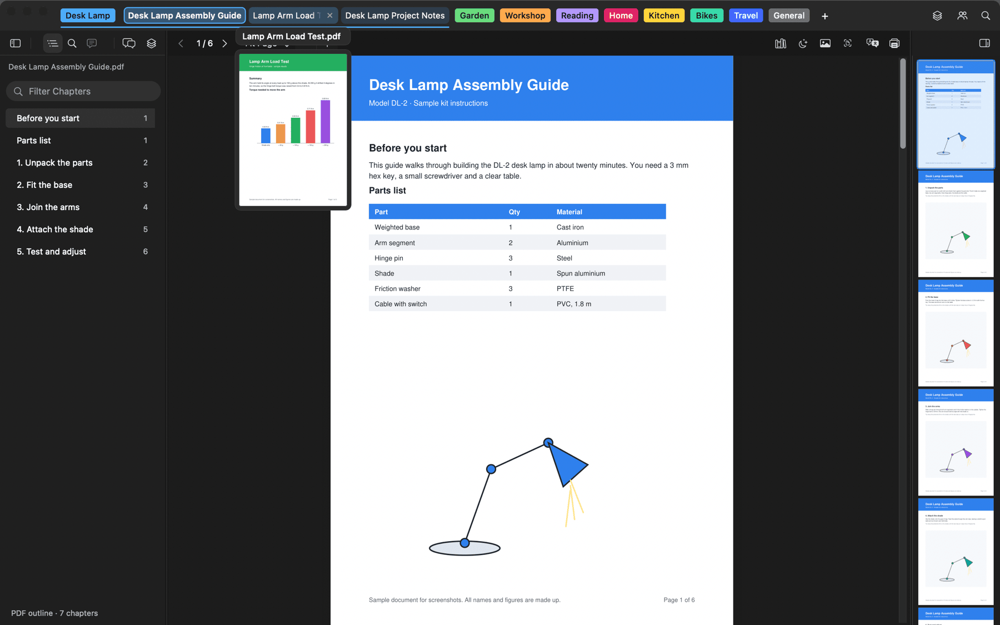
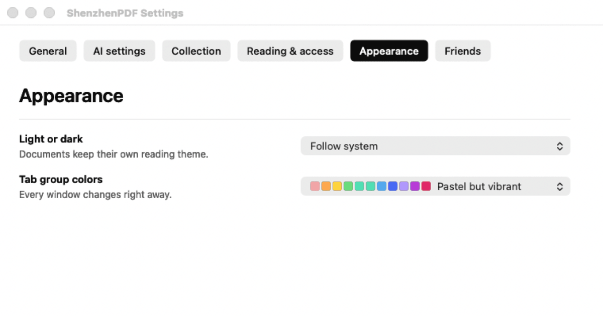
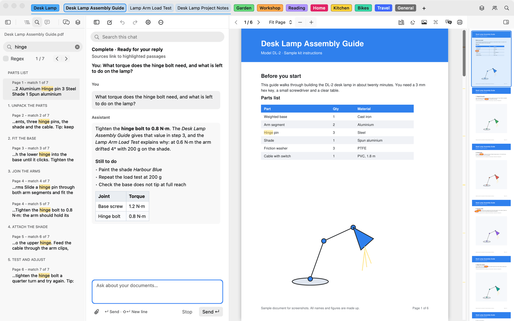
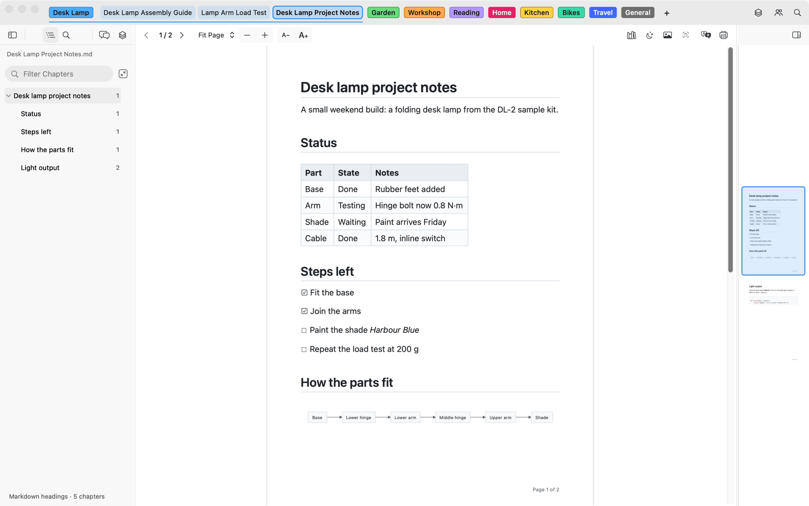
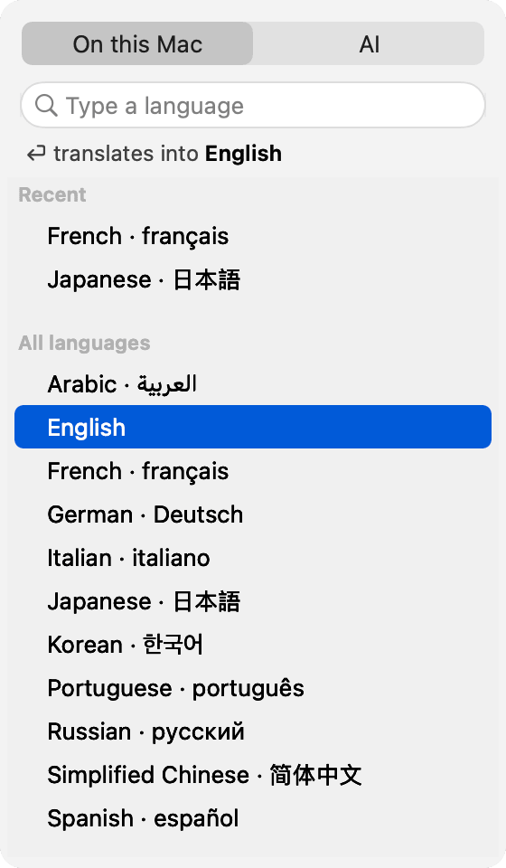
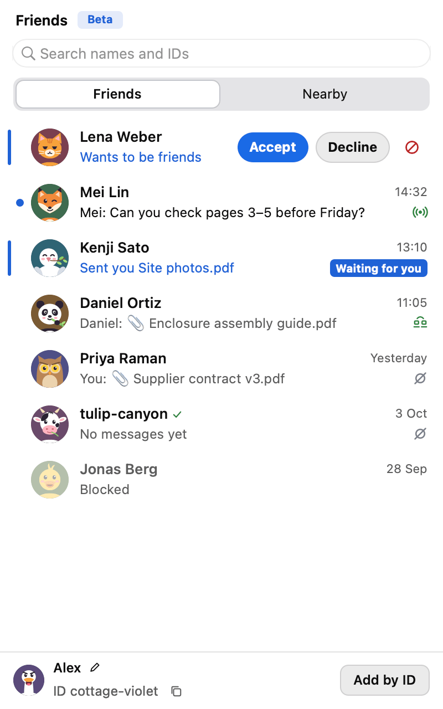
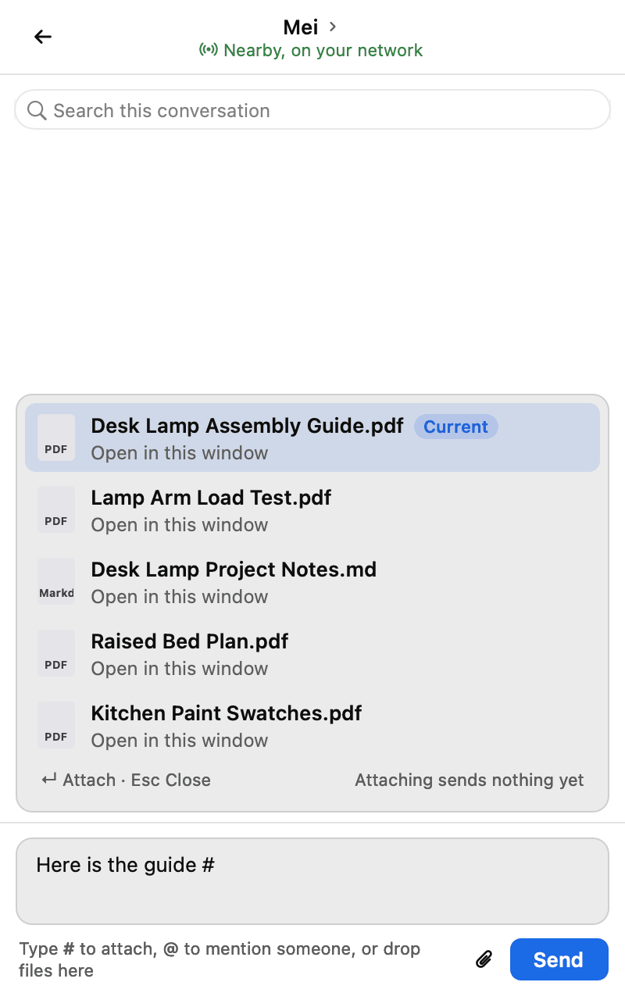

# Shenzhen PDF Reader

A fast, free, open-source document reader for the Mac. Keep your documents in colourful tab groups, find anything in them, and ask the assistant about them. Collection, your own document library on your Mac, keeps every version.

Reads PDF, EPUB, Markdown, plain text, code and images.

**[Download for Mac](https://github.com/casimir-engineering/shenzhen-pdf/releases/latest/download/ShenzhenPDF-mac-arm64.dmg)** · Apple Silicon · macOS 12+ · Signed and notarized

Latest <b>26.10.31-1</b> · [Release notes](https://github.com/casimir-engineering/shenzhen-pdf/releases/latest) · [Website](https://casimir-engineering.github.io/shenzhen-pdf/) · [中文](https://casimir-engineering.github.io/shenzhen-pdf/zh/)

<picture>
  <source media="(prefers-color-scheme: dark)" srcset="docs/images/portable/readme-reader-dark.png">
  
</picture>

All screenshots use made-up sample documents.

## Tabs and groups

- **Tab groups.** Put documents into named, coloured groups. Collapse a group to its name, open it again with a click, and drag tabs between groups and windows.
- **Page previews.** Hover a tab to see its current page under its full name, for every kind of document.
- **Your colours.** Pick the group colours in **Settings › Appearance**: Pastel but vibrant, Neon, Pastel, Cyberpunk, Apple system and more. Keep ShenzhenPDF light or dark, or follow your Mac.
- **Picks up where you left off.** Tabs, groups, windows, pages and zoom come back when you open the app again. It opens quickly, quits at once, and never asks you to save.

<picture>
  <source media="(prefers-color-scheme: dark)" srcset="docs/images/portable/readme-settings-dark.png">
  
</picture>

## Ask about your documents

- **Answers with sources.** Ask about the documents you have open or in Collection. Source links open the right document at the right page and highlight the passage.
- **Long tasks.** Ask it to sort dozens of documents into groups, rename them or close the ones you haven't looked at for a week. If a task is long, **Continue** picks up where it stopped. Undo puts things back.
- **Measures and makes files.** The assistant can work on your documents' pages and pictures to measure and calculate, and save tables, charts and reports to your Downloads folder and to Collection.
- **Drop files or folders into a chat** to ask about them. Only that chat can read them.
- **Summaries, tags and chapters** in your language, and chats you can save in folders, search and pick up again.

The assistant needs an [OpenRouter](https://openrouter.ai) account with credits. What it reads from your documents is sent to the model you choose. You can turn off the chat and the automatic analysis separately. Models can misread documents: check the sources it links. [Assistant guide](portable/docs/document-assistant.md)

## Markdown and code

Markdown opens as pages, with diagrams, maths, tables and highlighted code. Choose the paper size, margins and page breaks. When the file changes on disk, the pages and chapter list follow. Text and code files open with adjustable font size.

## Translate

**Translate** asks only for the language. English is highlighted, so Return translates at once; type a few letters to pick another, and your recent languages come first. Translate **On this Mac**, offline, or with **AI**, in any language you type. The translation opens next to the original, named after the language (“Datasheet (French).pdf”), keeps its chapters and shows only the translated text.

<picture>
  <source media="(prefers-color-scheme: dark)" srcset="docs/images/portable/readme-translate-dark.png">
  
</picture>

## Search

Start typing in a document to search it. Results are grouped by chapter, highlighted on the page and marked along the scroll bar, and even documents of thousands of pages show matches as they are found. **⌘K** searches every open document and Collection; with nothing typed, it lists what you read last.

## Collection

- Your document library on your Mac, with a saved copy of every version.
- Compare versions, reconnect a document whose file moved, and choose how much space Collection may use.
- Saved copies stay readable and editable when the original file is gone.
- **Move to Trash** from a tab, the page or Collection: the file goes to the Trash, where you can still put it back.

## Friends (Beta)

Message people nearby or by their Friends ID, and send them documents. Friends also works in Shenzhen Files and Shenzhen 3D.

- Type **#** in a message to attach a document: the one on screen comes first, marked **Current**.
- Paste (⌘V) to attach files copied in Finder, or a screenshot.
- Drop files on the Friends button to send them.
- Each friend's row shows the latest message in your conversation.
- Files go over every connection you share at once, such as your network and Bluetooth, and pick up where they stopped.

<picture>
  <source media="(prefers-color-scheme: dark)" srcset="docs/images/portable/readme-friends-list-dark.png">
  
</picture>

## Tools that run on your Mac

- **OCR** makes scans and photos searchable (OCRmyPDF and Tesseract).
- **Translation** of a selection or a whole document (Argos Translate).
- **Images:** paste, rotate, save as an image or PDF, copy as PDF.
- **Reading:** a dark reading theme, printing and PDF export.

OCR and translation run on your Mac once their tools and languages are downloaded. [Full feature list](docs/features.md)

## Links from websites

A website can link straight to a document in ShenzhenPDF, at a page, section or heading. The page shows while the rest downloads, and the document stays available offline. [How to make such links](docs/szpdf-links.md)

## Automation and other systems

[Command line, MCP and Markdown authoring guide](portable/docs/agent-interface.md): open and inspect documents, organize groups while the app is closed, go to and highlight passages, and control Markdown layout.

- **macOS:** the download above.
- **Linux:** a GTK 4 version; some features differ.
- **Windows:** a native version you can build from source; there is no download yet.

[Building and architecture](portable/README.md) · [Report an issue](https://github.com/casimir-engineering/shenzhen-pdf/issues)

## License

See [COPYING](COPYING), [COPYING.BSD](COPYING.BSD) and [NOTICE.md](NOTICE.md). Dependencies keep their own licenses. ShenzhenPDF is a separate project inspired by SumatraPDF, with no affiliation.
